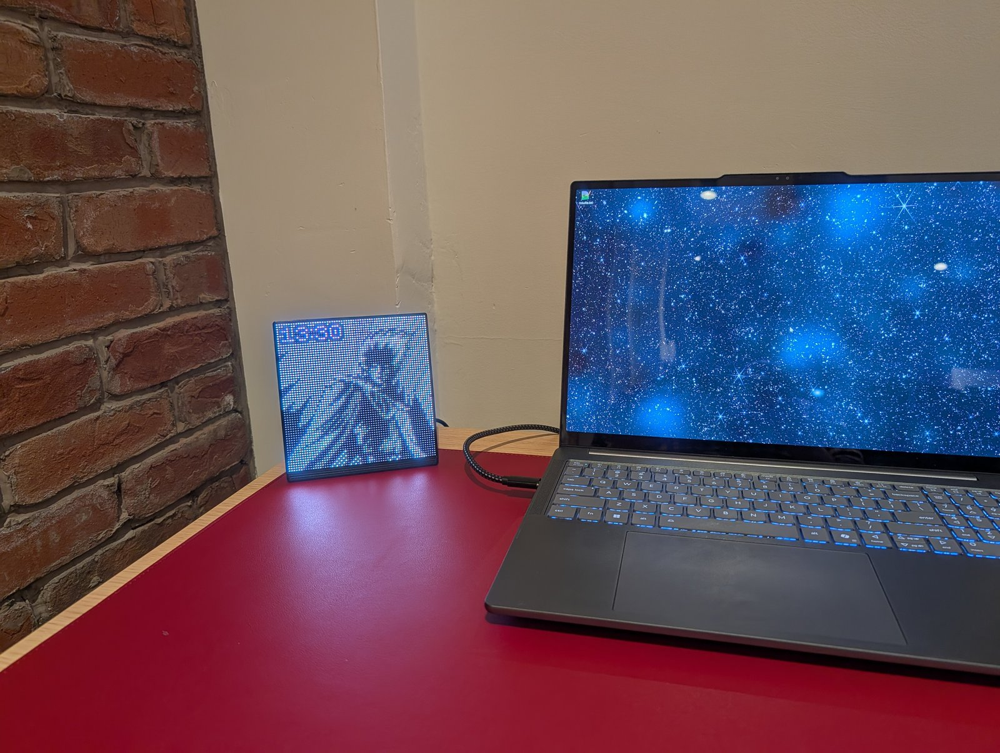
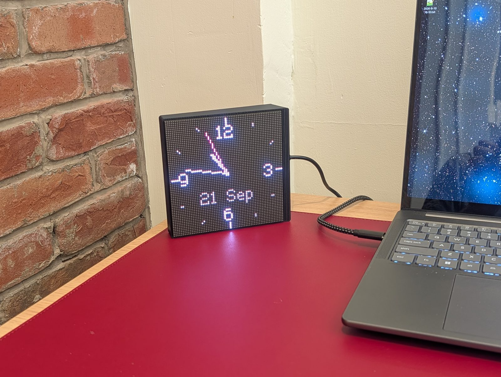
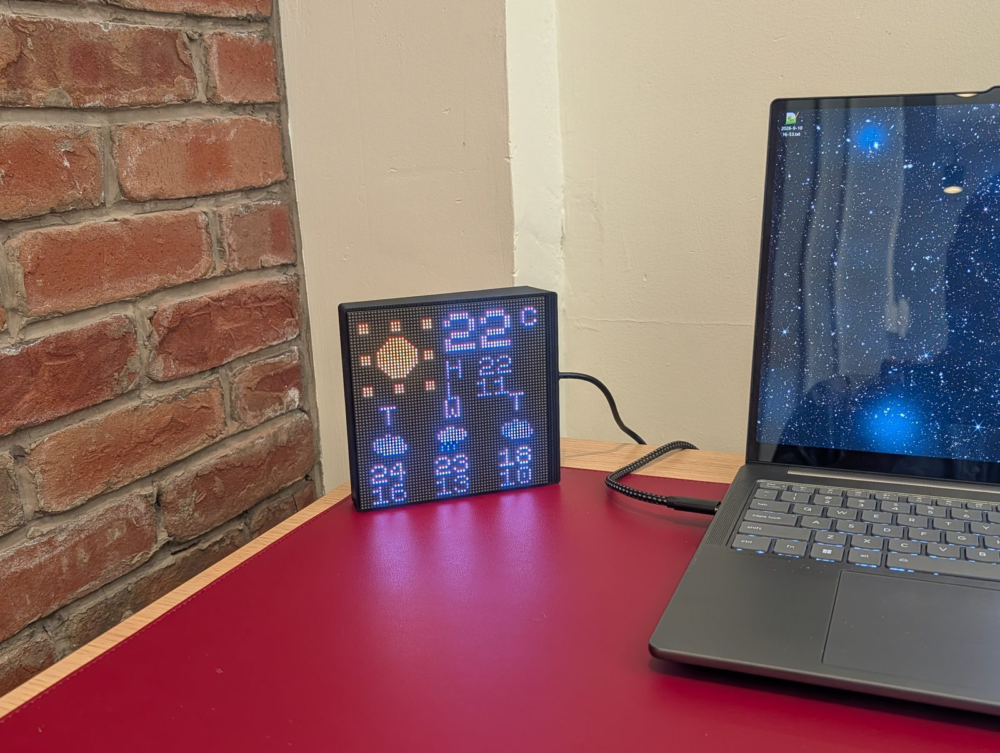
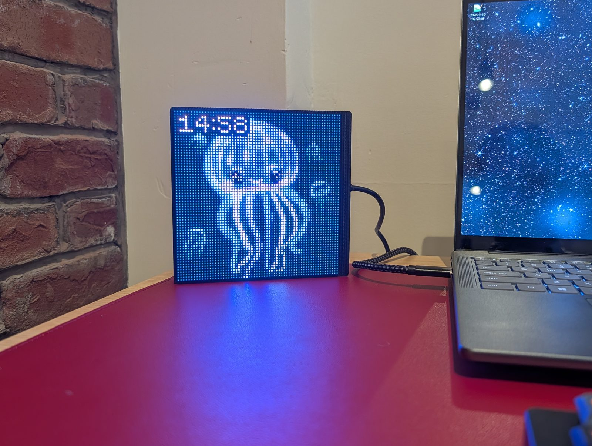

# p64

A small pixel-art display for your desk: 64×64 RGB LEDs in a 3D-printed shell,
powered over USB-C and controlled from a browser. Play animated artwork from a
microSD card or [Makapix Club](https://makapix.club), show clocks and widgets, or
stream pixels from your computer. The firmware and enclosure are open source.

**Working prototype:** p64a is assembled and in daily use. p64b is printed and awaits
its soldered wiring. Building currently follows the source-build guide; full
acceptance testing remains open. [Project status](docs/status.md)

**[Build one](docs/build-your-own.md)** · **[Use it](docs/using-p64.md)** ·
**[Develop it](firmware/README.md)** · **[Documentation](docs/README.md)**

|  |  |  |
|---|---|---|
| A landscape clock | An analogue face | Weather at a glance |

## What it does

- **Plays pixel art:** GIF, PNG/APNG, WebP and BMP, with transparency and pixel-aware
  scaling. Demanding animations slow down rather than skip frames.
- **Plays community artwork:** Makapix's Promoted channel needs no account. Pair for
  more channels, likes and sending artwork from the site. A card keeps cached art
  available offline; playsets mix channels.
- **Shows useful information:** clock faces and a time overlay, weather, air quality,
  UV, and the board's temperature sensor. A night schedule dims or blanks the panel.
- **Accepts live pixels:** DDP or raw p64 UDP from a computer, including screen capture
  with the bundled sender.
- **Offers browser controls:** mobile-friendly UI, live preview, optional PIN and a
  documented HTTP API. Tap gestures, auto-rotation and optional knobs add local control.
- **Supports firmware updates over Wi-Fi:** user-initiated installs with checksum
  verification and rollback.

Quality mode uses 11 bit planes at about 264 Hz; Photo mode raises refresh to about
814 Hz for cameras. Clocks require NTP after each boot. See the
[owner's guide](docs/using-p64.md) for operating limits.

|  |  |  |
|---|---|---|
| Colourful pixel art | Artwork with the time overlay | In low light |

[More photos, playback clips and the web UI](docs/gallery.md) · [Clock-face comparison](docs/using-p64.md#clocks-and-widgets)

## Choose a variant

| | p64a | p64b |
|---|---|---|
| Controls | Browser and tap gestures | Same, plus two rotary knobs |
| Soldering | None | Required for the encoder wiring |
| Shell | v7a | v7b |
| Assembly status | In daily use | Printed; soldering and assembly pending |

Both variants use the same firmware and remain supported. The build guide defaults
to p64a and links the extra p64b steps.

|  |  |
|---|---|
| A slim tabletop shell | The assembled p64a, from behind |

## Build one

You need a Waveshare ESP32-S3-RGB-Matrix controller, a P2 64×64 panel, a suitable USB-C
supply, the printed shell and insert, two right-angle USB-C adapters, and six M3×10
screws bought separately. A microSD card is optional. You also need a computer and a
USB data cable for the first flash.

For scale, the three main electronics parts totalled about **US$64** at the recorded
September 2026 prices. Printing, adapters, screws, shipping and optional p64b parts
are extra. The [build guide](docs/build-your-own.md#1-parts-and-tools) has the shopping
list and dated prices.

[Follow the build guide →](docs/build-your-own.md)

## Documentation

| I want to… | Read |
|---|---|
| Assemble and set up a device | [Build guide](docs/build-your-own.md) |
| Add artwork, choose widgets or recover a device | [Owner's guide](docs/using-p64.md) |
| Check readiness and known limits | [Project status](docs/status.md) |
| Build or change the firmware | [Firmware guide](firmware/README.md) |
| Print or modify the shell | [Enclosure guide](enclosure/README.md) |
| Write a client | [HTTP API](firmware/docs/api.md) |
| Find specifications, decisions and history | [Documentation index](docs/README.md) |

## About

p64 is a sibling of [p3a](https://github.com/fabkury/p3a), the same author's ESP32-P4
pixel-art player, and a player for [Makapix Club](https://makapix.club).
Development history includes the [session prompts](prompt/) and
[hardware test records](firmware/reference/hardware-tests/README.md).

Project code and documentation use [Apache 2.0](LICENSE). Third-party components and
assets retain their own licenses; see [credits](docs/credits.md).
