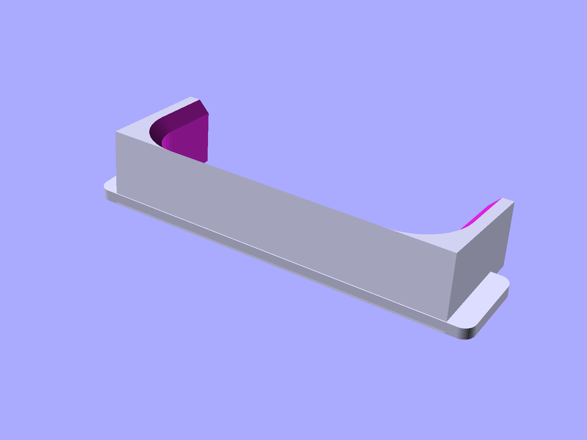
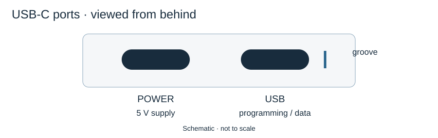
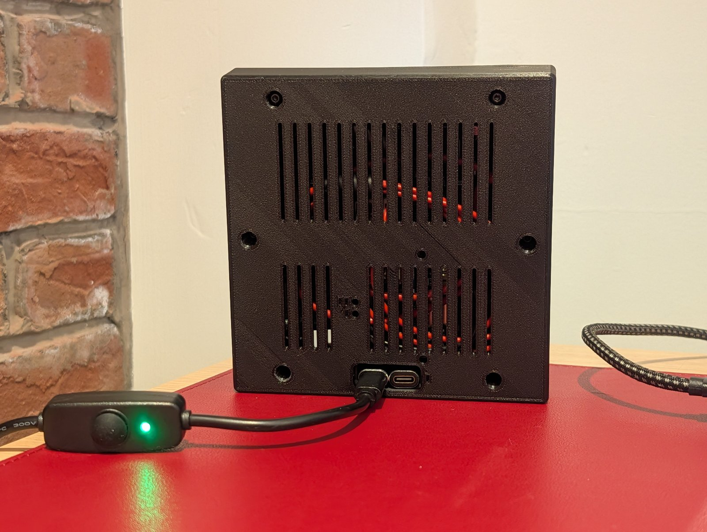
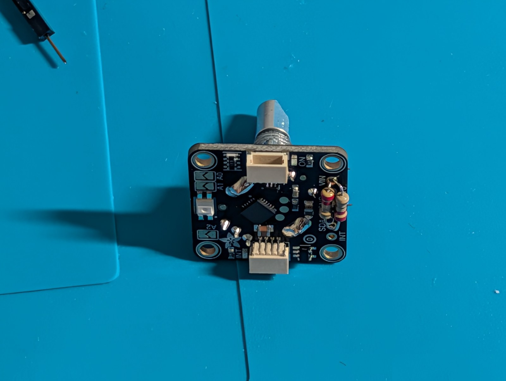
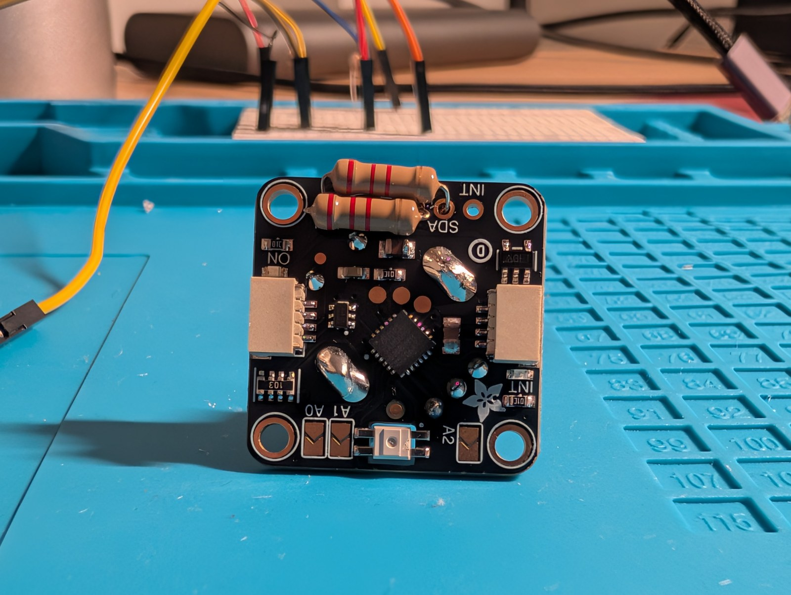
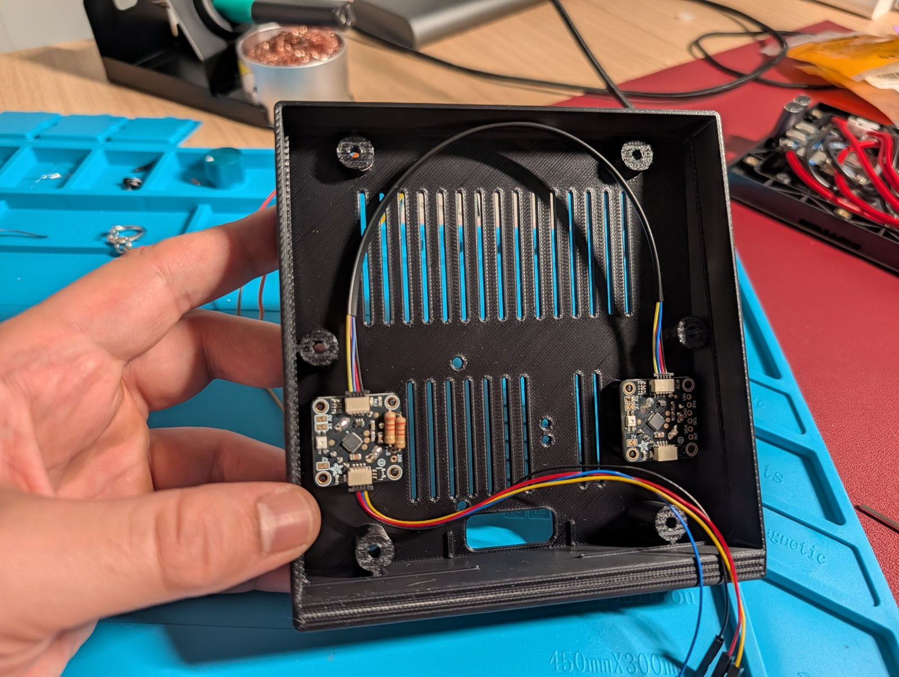
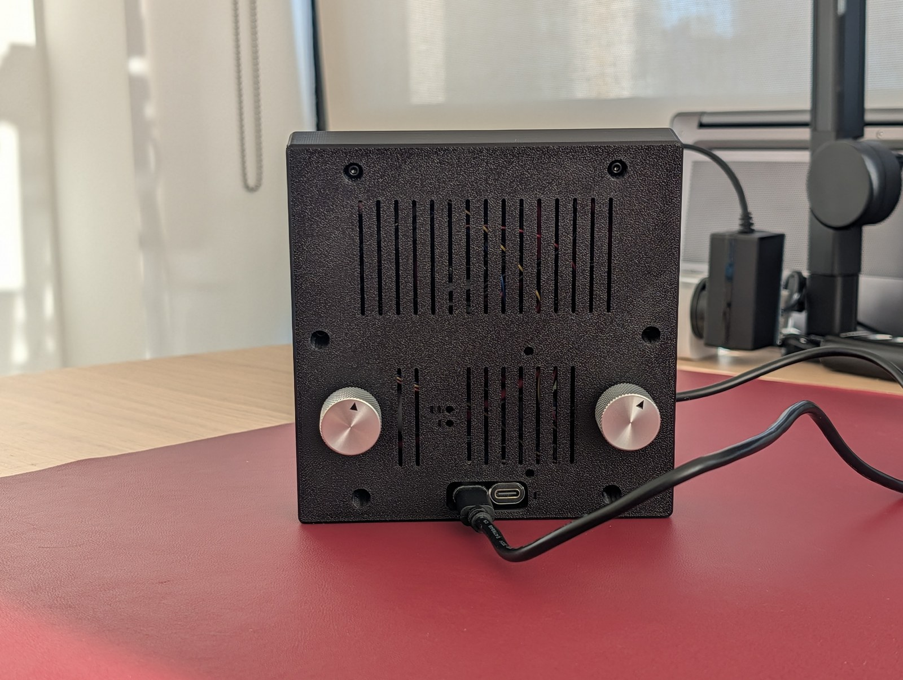

# Build your own p64

[Home](../README.md) · [Owner's guide](using-p64.md) · [Project status](status.md) ·
[Build costs](costs.md)

Building a p64 is four steps, three of them shopping and waiting:

- **A. [Buy the parts online](#a-buy-the-parts)**: three items from Waveshare, two from
  Amazon. p64b adds a handful of Adafruit parts.
- **B. [Order the shell from JLC3DP](#b-order-the-shell-from-jlc3dp)**: upload two files,
  choose a material and a colour, pay. No printer needed.
- **C. [Assemble](#c-assemble)**: p64a is a screwdriver job. p64b first needs three small
  soldering jobs, then the same assembly. No breadboard; a multimeter is optional.
- **D. [Put the firmware on it](#d-put-the-firmware-on-it)**: the one computer step. Until
  a firmware release is published it means building from source, about an hour the
  first time.

Then the [first run](#e-first-run): join its Wi-Fi setup network and it plays.

**p64a** has no soldering and no knobs; **p64b** has two rotary knobs and three solder
joints. Both use the same firmware and both are assembled and in daily use (p64a since
2026-10-09, p64b since 2026-10-17). This guide builds p64a and marks the p64b additions.

## A. Buy the parts

Every link is the listing the maintainer bought from or recommends; prices are what
the listing showed on the date given, in US dollars, before shipping and tax. The
[build costs](costs.md) page has the invoices and the per-build totals.

### A.1 p64a and p64b alike

| Qty | Part | Where | Price seen |
|---|---|---|---|
| 1 | [ESP32-S3-RGB-Matrix](https://www.waveshare.com/esp32-s3-rgb-matrix.htm) controller board (SKU 34422) | Waveshare | $24.99, 2026-09-02. The box includes the panel power lead and a short 4-pin cable. |
| 1 | [RGB-Matrix-P2-64x64-B](https://www.waveshare.com/rgb-matrix-p2-64x64.htm?sku=33838) panel, GOB version (SKU 33838) | Waveshare | $31.99, 2026-09-02. The standard (non-GOB) version, SKU 23706, fits the same shell. |
| 1 | [PSU-27W-USB-C](https://www.waveshare.com/psu-27w-usb-c-c.htm) power supply; pick the US, EU or UK plug on the page | Waveshare | $6.99, 2026-09-02. Any 5 V USB-C supply rated 3 A or more also works. |
| 2 | [Right-angle USB-C male-to-female adapters, 2-pack](https://www.amazon.com/dp/B0B2NJ3P3L) (AreMe, metallic purple) | Amazon | $4.99, 2026-10-19. [This 4-pack](https://www.amazon.com/dp/B0H3JNGX1D), $6.99 on 2026-10-10, is what the maintainer's own units use. |
| 6 | [M3 × 10 mm button-head hex screws, 50-pack](https://www.amazon.com/dp/B0GJK7Z9DH) (MoyoCodi, black stainless; choose size "M3 x 10mm") | Amazon | $5.99, 2026-10-19. The pack includes the 2 mm hex key that drives them. |
| 1 | USB-C data cable | any | For the first flash. A charge-only cable cannot flash. The supply's own cable powers the device. |
| a dab | Cyanoacrylate glue or double-sided tape | any | Holds the printed cradle insert. |
| optional | microSD card, FAT32 | any | Local artwork files and a persistent cache. |

Order the Waveshare items together: their freight to New York was $25.60 for the three
parts in one box (2026-09-02).

Why these adapters: the shell's back window is sized for a 19.3 × 12.7 × 8.0 mm adapter
body with a 7.7 mm plug. Both linked listings fit (confirmed 2026-10-15). A different
shape needs the [measurements](../enclosure/input/measurements.md#90-degree-usb-c-adapter-two-one-per-driver-board-port)
checked first.

### A.2 p64b only

| Qty | Part | Where | Price seen |
|---|---|---|---|
| 2 | [Adafruit 5880](https://www.adafruit.com/product/5880) I2C QT rotary encoder breakout, with the encoder soldered on | Adafruit | $7.95 each, 2026-09-11. One becomes knob A, the other knob B. Each encoder brings its own nut and washer. |
| 2 | [Adafruit 5528](https://www.adafruit.com/product/5528) 20 mm silver aluminium knob ([5529](https://www.adafruit.com/product/5529) is the same knob in blue) | Adafruit | $2.95 each, 2026-09-11. Any knob with a 6 mm bore fits; the shell was drawn for 20 mm. |
| 1 | [Adafruit 4209](https://www.adafruit.com/product/4209) STEMMA QT cable to male header pins, 150 mm | Adafruit | $0.95, 2026-09-11. Plugs into the controller. |
| 1 | [Adafruit 4397](https://www.adafruit.com/product/4397) STEMMA QT cable to female sockets, 150 mm | Adafruit | $0.95, 2026-09-11. Plugs into board A; its sockets take the 4209's pins. |
| 1 | [Adafruit 4401](https://www.adafruit.com/product/4401) STEMMA QT cable, 200 mm | Adafruit | $1.25, 2026-09-27. Board A to board B. |
| 2 | [2.2 kΩ ¼ W resistors, 100-pack](https://www.amazon.com/dp/B08QRPRVMJ) (Chanzon, metal film) | Amazon | $5.49, 2026-10-19. The maintainer's build used ½ W ones from a 40-pack ($3.99, 2026-09-17); ¼ W lie flatter. |
| some | Electrical tape, or [Adafruit 1649](https://www.adafruit.com/product/1649) heat-shrink pack | any | Wraps the four cable joints. |

Tools for p64b: a soldering iron with a fine tip and electronics solder, flux if you
have it, small side cutters, and the 2 mm hex key from the screw pack (it also fits
the knobs' set screws). A multimeter is optional and recommended.

### A.3 What it costs

From the maintainer's invoices, shipped to New York (details in [build costs](costs.md)):

| Build | Parts | Shipping | Tax | Delivered |
|---|---:|---:|---:|---:|
| p64a | $86.25 | $31.84 | $0.97 | $119.06 |
| p64b | $115.06 | $37.66 | $4.04 | $156.76 |

## B. Order the shell from JLC3DP

The shell is two printed parts: the shell itself and a small cradle insert. The
maintainer had both printed by [JLC3DP](https://jlc3dp.com) in black PLA, twice; the
v7 shells of 2026-09-28 arrived on 2026-10-09, eleven days after ordering, and cost
$10.23 (p64a shell) or $10.10 (p64b shell) plus $1.07 for the insert, before shipping.
Nothing below needs a 3D printer or any experience with one.

**1. Download the two files.** Pick your variant and save both files to your computer
(each link opens the file on GitHub; use its **Download raw file** button, the icon
with the arrow at the top right of the file view):

| | Shell | Cradle insert |
|---|---|---|
| p64a | [p64_enclosure_print.stl](../enclosure/output/p64a/v7a/p64_enclosure_print.stl) | [p64_cradle_insert.stl](../enclosure/output/p64a/v7a/p64_cradle_insert.stl) |
| p64b | [p64_enclosure_print.stl](../enclosure/output/p64b/v7b/p64_enclosure_print.stl) | [p64_cradle_insert.stl](../enclosure/output/p64b/v7b/p64_cradle_insert.stl) |

The folders also hold a `.3mf` copy of the shell (for home printers) and
`p64_enclosure_service.stl` (a looser fit, for nylon and resin processes); do not
upload those.

**2. Open the quote page.** Go to [jlc3dp.com](https://jlc3dp.com) and click
**Order Now** at the top right. The page "Online 3D Printing Quote" opens with the
**3D Printing** product tile selected.

**3. Upload.** Click **Upload 3D models** and choose both `.stl` files. Each appears
as a line in the list, with a price.

**4. Set the options for each file.** Click **Edit Specifications** on a line and
choose, top to bottom:

| Option | Choose |
|---|---|
| 3D Technology | **FDM(Plastic)** |
| Material | **PLA-P** (JLC3DP's name for plain PLA since 2026; the page says the rename changed nothing) |
| Color | **Black** |
| Thread | **No** |
| Package Box | either |
| Qty | **1** |
| Product Desc | "Enclosure, Block, Plate, Cylinder" category, if the form asks for one |

Click **Save**, then repeat for the second file. Both parts print without supports and
need no finishing. The insert's 1.2 mm sole is at the service's minimum wall; their
file check accepted it (a thinner draft was flagged).

**5. Order.** On the right, leave **Build Time** at **Standard**, tick **I agree to
JLC3DP's terms of use** and click **Submit Order**. You need a JLC3DP account (sign in or
create one when asked), then it asks for a shipping address and a shipping method (choose the
cheapest tracked one; the maintainer's two-shell order paid $11.97 of shipping and a
$0.50 payment fee), then for payment.

**If you have your own printer** instead: PLA or PETG, 0.2 mm layers, 3 to 4
perimeters, 20 % infill, no supports, a bed of at least 140 × 140 mm, 0.1 to 0.2 mm
elephant-foot compensation. The shell file already lies in its print orientation;
print the insert sole down. About 82 g plus 2 g. The
[enclosure guide](../enclosure/README.md) and
[design reference](../enclosure/design-reference.md) have the rest.

**When it arrives:** check that the six screw holes are clear, the insert sits between
its two rails on the inside of the back wall, and (p64b) the two round holes in the
back are open.



The cradle insert, the second of the two prints (CAD view).

## C. Assemble

Everything here is done with the power unplugged. The firmware step (D) can come
before or after this one: the controller's USB port stays reachable through the back
window once the shell is closed. **For p64b, do D first:** the firmware's start-up
lights are how you check the soldering.

### C.1 p64a: screwdriver only

1. Plug the controller onto the panel's **HUB75 IN** connector (the connector at the
   panel's edge; the controller's pins and the connector's key only fit one way).
2. Connect the panel's power lead that came in the controller's box: the white VH4
   plug into the panel, the red wire into **5V** and the black wire into **GND** at
   the controller's screw terminals.
3. Push one right-angle adapter fully onto each of the controller's two USB-C ports,
   bodies toward the edge of the panel frame. Leave the panel's plastic frame as it
   is; nothing needs cutting.
4. Dry-fit: lower the panel into the shell with the controller at the **bottom** and
   the adapters pointing at the back window. The insert goes between its two rails,
   flat against the inside of the back wall, around the adapter bodies. Everything
   should seat without force. Take the panel out again.
5. Glue the insert: a thin bead of cyanoacrylate along the outer edge of its sole,
   away from the opening (or double-sided tape). Seat the panel again, letting the
   adapters position the insert, fit two screws and leave the glue to set.
6. Fit all six M3 × 10 screws from the back with the hex key from the pack. Snug, not
   tight.
7. Plug the supply into **POWER**, the left port viewed from behind. **USB**, on the
   right, has a groove beside it and is the one the computer uses.





The assembled p64a: supply in POWER, USB free for the computer.

**Check:** the panel sits flat, the adapters stay put when a cable is plugged and
unplugged, and the device stands on its own. The firmware's default image rotation
already matches the shell.

### C.2 p64b: solder three things, then assemble

The two encoder boards talk to the controller over its spare 4-pin "GPIO" socket. The
wiring needs exactly three solder jobs, all on the boards, none on the controller, and
the cables join by plugging into each other. Full detail, the reasons, the optional
meter checks and the troubleshooting table are in the
[two-encoder guide](hardware/encoders-soldered.md); this is the short form.

Decide which board is **A** (brightness and pause) and which is **B** (next artwork
and like); a dot of marker on B's edge saves confusion later.

**Job 1: one blob of solder on board B.** On the back of each board (the side without
the encoder) are three pairs of tiny pads labelled **A0**, **A1**, **A2**. On board B
only, join the two **A0** pads with a small bead of solder: touch the hot, tinned tip
flat across both pads for a second, lift straight up. The result is a shiny bridge
across the A0 gap and nothing touching A1. That gives board B a different address
from board A, so the firmware can tell them apart. Board A's pads stay untouched.



The back of a board: the A0, A1, A2 pads are at the left edge, the six header holes
(VIN, 3Vo, GND, SCL, SDA, INT) at the right. This is board A, with its resistors
already fitted; board B gets the A0 bridge and no resistors.

**Job 2: two resistors on board A.** Along one edge of the board are six plated holes
labelled **VIN, 3Vo, GND, SCL, SDA, INT**. On board A only, solder one 2.2 kΩ
resistor between **VIN** and **SDA** and the other between **VIN** and **SCL**: bend
the leads, push them through from the encoder side, solder each on the back (touch
pad and lead, feed solder for a second, lift), cut the leads flush. The two leads
that share the VIN hole go in from opposite sides, or get twisted together first.
Nothing on board B.



Board A as built on 2026-10-17: the two resistors standing on the header holes.

**Job 3: plug the two cables into each other** (no solder). The controller's socket
and the boards' sockets use different pin orders, so a plain cable between them
would be wrong. Instead, push each pin of the 4209 cable into one socket of the 4397
cable, **crossing the two signal colours**:

| 4209 pin (controller end) | into 4397 socket (board end) |
|---|---|
| yellow | **blue** |
| blue | **yellow** |
| red | red |
| black | black |

Wrap each of the four joints in tape or heat-shrink so no two touch. Mark the
cable's 4209 end "controller". If you would rather solder the wires than mate the
pins, the [long guide](hardware/encoders-soldered.md#5-the-cables)
describes the splice.

**Test it** (needs the firmware, step D): plug the 4209's plug into the controller's
4-pin GPIO socket on the controller's right edge; the keyed plug fits one way, and the
black wire lands on the pin marked GND. Plug the 4397's plug into board A, the 4401
from board A's other socket to board B, and power the controller from USB. Within a
few seconds board A's small colour LED flashes **green** and board B's flashes
**blue**. Both green means job 1 did not take; one dark means its cable; the
[troubleshooting table](hardware/encoders-soldered.md#9-what-can-go-wrong) has the
rest. Optional meter checks are in the long guide's
[section 8](hardware/encoders-soldered.md#8-optional-checks-with-a-multimeter-or-a-breadboard).

**Fit the boards** (power off, before the panel goes in):

1. Inside the shell, each of the two round holes in the back wall has four small pegs
   around it. Board **A** (the one with the resistors) goes to the **right-hand** hole
   seen from the back, nearest the controller's socket; board B to the left. Plug the
   cables into the boards first: once mounted, the sockets face up and down, 4.5 mm
   from the side wall.
2. Turn each board so its two cable sockets point up and down and its six header
   holes face the centre of the shell (the only way it fits), and push it onto its
   pegs with the shaft through the hole, until the threaded bushing sits flat on the
   wall. A tight peg gets a light trim, not force.
3. From outside: washer, then nut, finger-tight.
4. Knob on, with about **1 mm of shaft showing above the nut**, and tighten its set
   screw onto the flat of the shaft with the 2 mm hex key. A knob pushed all the way
   down rests on the nut and its click never registers.
5. Route the harness: from the controller's socket to board A, slack coiled flat
   against the back wall away from the power lead and the adapters; the 4401 from
   board A down along the bottom of the cavity, above the adapters, and up into
   board B.

|  |  |
|---|---|
| Both boards on their pegs, cables in, before the panel | The result: two knobs through the back wall |

Then connect the 4209 to the controller and continue with the p64a steps above
(controller onto the panel, power lead, adapters, insert, six screws). Finally turn
each knob a few clicks and press it: brightness and pause on A, next artwork on B.

## D. Put the firmware on it

No firmware release is published yet, so the firmware is built from source; this is
the one step that needs a computer with developer tools. Allow an hour the first time,
most of it the ESP-IDF installer. Check
[GitHub Releases](https://github.com/fabkury/p64/releases) first: once a release with a
flashable image exists, this step shrinks to one flashing command.

1. Install Git, PowerShell 7 (Windows) and **ESP-IDF v5.5.4** for the ESP32-S3,
   following [Espressif's instructions](https://docs.espressif.com/projects/esp-idf/en/v5.5/esp32s3/get-started/index.html).
   Windows is the workflow the maintainer uses; Linux builds run in CI; macOS and
   Linux flashing have not been tried by the maintainer.
2. Clone the repository and enter the firmware folder:

   ```powershell
   git clone https://github.com/fabkury/p64.git
   cd p64/firmware
   ```

3. Connect the computer to the controller's **USB** port with the data cable (on the
   assembled device: the right-hand port from behind, with the groove). **POWER**
   carries no data.
4. On Windows, set the three installation paths at the top of
   [tools/env.ps1](../firmware/tools/env.ps1) (`IDF_PATH`, `IDF_TOOLS_PATH`,
   `IDF_PYTHON_ENV_PATH`) to your install, then run:

   ```powershell
   .\tools\build.ps1
   .\tools\flash.ps1
   .\tools\monitor.ps1
   ```

   The scripts load ESP-IDF and find the port. Ctrl+] leaves the monitor. If the port
   is not found, name it: `.\tools\flash.ps1 -Port COM7`. If flashing does not start,
   hold BOOT, tap RESET, release BOOT (both buttons are on the controller; on a closed
   shell this needs the panel out, which is why p64b flashes before assembly).

   On Linux or macOS, source ESP-IDF v5.5.4's `export.sh`, then from `firmware/`:

   ```sh
   idf.py set-target esp32s3
   idf.py build
   idf.py -p /dev/ttyACM0 flash monitor
   ```

   with your port in place of `/dev/ttyACM0`.

**Check:** the monitor shows p64 starting. Later updates arrive over Wi-Fi through the
web UI's Update page; the [firmware guide](../firmware/README.md) covers rebuilding.

## E. First run

1. Optional: with the power off, insert a FAT32 microSD card with an artwork in
   `p64/animations/`.
2. Power on. With no known network, a Wi-Fi network named **p64-setup** appears
   within about a minute. Join it; open [192.168.4.1](http://192.168.4.1) if the setup
   page does not open by itself.
3. Choose your **2.4 GHz** network, type its password, optionally name the device,
   save. The device reboots; rejoin your own network.
4. Open [p64.local](http://p64.local) (or `http://p64-<name>.local` for a named
   device). If `.local` does not resolve, use the address from your router's client
   list.
5. Set the time zone under **Settings → Network**. Choose **Local** to play card files
   or **Promoted** for Makapix artwork without an account; downloads start once Wi-Fi
   and the time sync are up.

**Check:** artwork plays and Home's next and pause controls respond. Continue with the
[owner's guide](using-p64.md) and its [troubleshooting](using-p64.md#troubleshooting).
