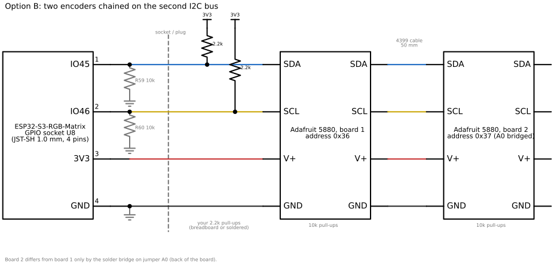
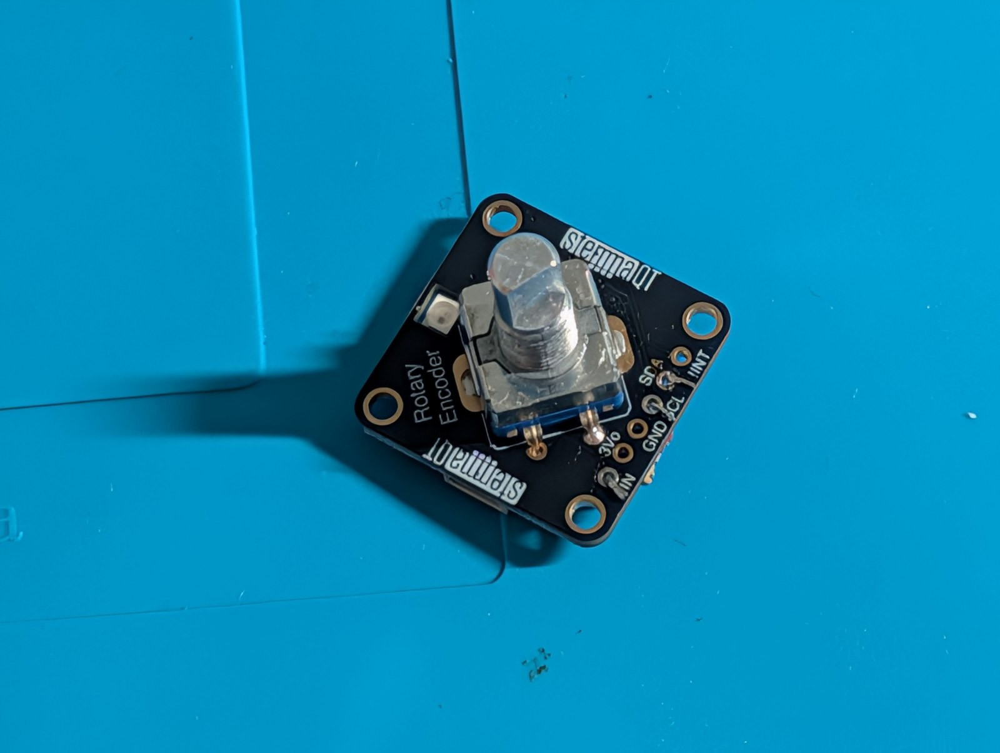
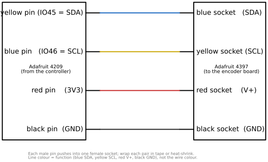
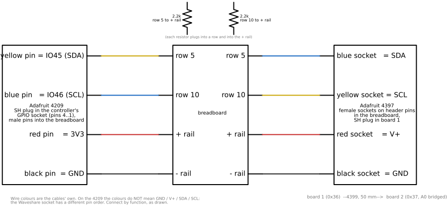

# p64b: two rotary encoders

[Build guide](../build-your-own.md) · [Project status](../status.md) · [Bench history](encoder-history.md)

How the two knobs of p64b are wired: two Adafruit 5880 encoder boards on the
controller's spare 4-pin socket. The work is three small jobs on the boards, two of
them with a soldering iron, then plugging the cables together and fitting the boards in
the v7b shell. No breadboard is needed; a multimeter is optional. The
[build guide](../build-your-own.md#c2-p64b-solder-three-things-then-assemble) has the
short form of this page; here are the details, the reasons, the optional checks and
what can go wrong. The firmware is implemented and the assembled p64b is verified
(section 6.1).

1. [Parts](#1-parts) and [what goes where](#2-what-goes-where).
2. [Job 1: the A0 bridge on board B](#3-job-1-the-a0-bridge-on-board-b).
3. [Job 2: the pull-up resistors on board A](#4-job-2-the-pull-up-resistors-on-board-a).
4. [The cables](#5-the-cables), then [check it with the firmware](#6-check-it-with-the-firmware).
5. [Fit it in the shell](#7-in-shell-assembly).

p64a has no encoders and skips this page. The
[one-encoder experiment](encoders-solderless.md) keeps the electrical derivation and
the alternatives that were not taken. The figures are generated by `tools/draw_encoders.py`.

## 1. Parts

The [p64b shopping list](../build-your-own.md#a2-p64b-only) has the links. Tools: a
temperature-controlled iron with a fine tip, electronics solder, flux if you have it,
side cutters, tape or heat-shrink, and the 2 mm hex key from the screw pack for the
knobs. A multimeter helps with the optional checks in section 8; the firmware's own
start-up lights are the real test. The [purchasing history](encoder-history.md#1-parts)
is kept as a record.

## 2. What goes where

| Fact | Consequence |
|---|---|
| The controller's only spare connector is the 4-pin JST-SH "GPIO" socket on its right edge: pin 1 IO45, 2 IO46, 3 3V3, 4 GND (schematic) | a second I2C bus, IO45 = SDA, IO46 = SCL |
| STEMMA QT order is GND, V+, SDA, SCL; the socket's is signal, signal, 3V3, GND | never a straight SH-to-SH cable to the controller; the 4209 and 4397 cables are joined by function, which crosses the two signal colours |
| IO45/IO46 carry 10 k pull-downs on the controller (R59/R60); each 5880 has 10 k pull-ups | the two boards alone would idle at 2.20 V, below the 2.475 V threshold; one 2.2 k per line to 3.3 V lifts it to 2.86 V |
| Two seesaw boards need different addresses | board B gets its A0 jumper bridged: 0x37 instead of 0x36 |
| IO46 high at reset could break the manual download mode | normal flashing works with the harness attached (tested 2026-09-26); if ever needed, unplug the 4209 to flash |



```
 controller GPIO socket           2.2k pull-ups on board A      board A (0x36)      board B (0x37, A0 bridged)
 IO45 (R59 10k to GND) ---SDA---+----[2.2k]---VIN -------------- SDA ---- SDA ---4401--- SDA
 IO46 (R60 10k to GND) ---SCL---+----[2.2k]---VIN -------------- SCL ---- SCL ---4401--- SCL
 3V3 -------------------------------------------------------- V+  ---- V+  ---4401--- V+
 GND -------------------------------------------------------- GND ---- GND ---4401--- GND
```

Board **A** is the one with the resistors and the unbridged pads (address 0x36): knob A,
brightness and pause. Board **B** has the A0 bridge and no resistors (0x37): knob B,
next and previous artwork, like. Mark B's edge before you start.

The two sides of a board, with everything this page refers to:

|  |  |
|---|---|
| Encoder side: the six header holes along one edge | Back: the A0, A1, A2 pads at the left; this is board A, resistors already in |

## 3. Job 1: the A0 bridge on board B

The smallest soldering job there is: joining two pads 0.3 mm apart with one bead of
solder, on the board that will be knob B.

**Test the board before the iron touches it** (lesson of 2026-09-27: the first board B
was bridged untested and then answered at no address, so whether it arrived dead was
never known). With the firmware on the controller (section 6), plug the untouched board
alone onto the harness and power up: its colour LED lights green and
`GET /api/v1/diag/encoders?scan=1` lists 0x36. Then bridge A0 and plug it alone again:
blue, and 0x37.

### 3.1 Setup

- Iron at 330 °C for leaded 63/37 solder (320 to 350 °C; lead-free needs 350 to
  380 °C). A fine conical or small chisel tip. Ventilate, do not breathe the smoke, wash
  your hands after leaded solder.
- Tin the tip: melt a little solder onto it, wipe it on the brass wool; it should be shiny.
- Board back side up, held with a bit of tape. The three jumpers **A0, A1, A2** are
  along one edge (photo above); each is a pair of small pads with a narrow gap. Only
  A0 is touched.

### 3.2 The bridge

1. Dab flux on the A0 pads (optional, but it makes step 3 a one-touch job).
2. Put a small bead of solder on the tip.
3. Touch the tip flat across both pads for one to two seconds. The solder flows onto
   both pads and fills the gap. Lift the iron straight up.
4. Look at it under good light: a smooth, shiny bridge spanning both pads, not a ball
   sitting on one pad, and nothing touching the neighbouring A1 pads or any trace.
5. If it bridged only one pad, add flux and touch again. If it bridged A0 and A1
   together, drag the tip across the excess to pull it away, or add flux and wipe the
   tip along the gap; the surplus follows the tip. If that fails, lay solder wick on
   the bridge and press the iron on the wick for two seconds, then start again.
6. Clean the flux with isopropyl alcohol on a cotton swab.

### 3.3 Checks

- Under a magnifier or the phone camera zoomed in: a continuous, shiny bridge across
  the A0 gap, with a clear dark gap to A1 on both sides.
- The real test is the firmware (section 6): the board answers at 0x37 and its LED
  flashes blue. A board that still answers at 0x36 has an open bridge; one at 0x38 has
  A1 bridged instead; 0x39 means A0 and A1 together (fix it, step 5 above).
- With a multimeter: section 8.1.

## 4. Job 2: the pull-up resistors on board A

The 5880 has a row of six plated holes along one edge: **VIN, 3Vo, GND, SCL, SDA,
INT** (the silkscreen names them; photo in section 2). The pull-ups go to **VIN**, the
3.3 V the controller supplies and the level the board's own pull-ups use.

1. Bend each resistor's leads so it can stand on the board's back, one lead in the
   VIN hole, the other in the SDA hole for the first resistor and the SCL hole for the
   second. Two leads share the VIN hole: push one through from each side, or twist the
   two lead ends together first. With ½ W bodies this is bulky; ¼ W resistors lie flat
   between the holes.
2. Solder each lead in its hole from the component-free side: touch pad and lead with
   the tip, feed solder for one second, lift. A good joint is a shiny cone wetting both
   the pad and the lead.
3. Cut the leads flush with side cutters.
4. Look at each joint: a shiny cone with clear gaps to the neighbouring holes. Solder
   across two adjacent holes is the one thing to fix (a VIN-to-GND short shows as the
   board never lighting its LED). With a multimeter: section 8.1.

Board B gets no resistors: one pair per bus.


Board A as built on 2026-10-17: the two ½ W resistors standing on the header holes.

## 5. The cables

### 5.1 Controller to board A: mated (no solder)

This is what the assembled p64b uses. Each male pin of the 4209 pushes into one female
socket of the 4397, paired by function, each joint wrapped in tape or heat-shrink:



```
 4209 (controller)            4397 (board A)
 yellow pin (IO45 = SDA) --->  blue socket   (SDA)
 blue pin   (IO46 = SCL) --->  yellow socket (SCL)
 red pin    (3V3)        --->  red socket    (V+)
 black pin  (GND)        --->  black socket  (GND)
```

The colours cross on purpose: Adafruit colours its cables by STEMMA QT function, and
the controller's socket puts the signals on different pins. The keyed plug settles
which 4209 wire is which (found 2026-09-26): yellow = IO45 (SDA), blue = IO46 (SCL),
red = 3V3, black = GND; the black wire lands on the socket pin next to the board's GND
label. Before the first power-up, read the silkscreen beside the socket once more and
confirm black on GND and red on 3V3: those two are the pair whose swap could damage a
board; the two signal wires swapped only make the firmware fail to find the boards.

### 5.2 Controller to board A: spliced (solder)

Cut the header end off the 4209 and the socket end off the 4397, leaving the lengths
the shell needs (about 60 mm each is plenty: the GPIO socket is 20 mm from the
right-hand board). Strip 5 mm of each wire, slide a 20 mm piece of 2 mm heat-shrink
onto one side, twist the pairs by function (yellow-4209 to blue-4397, blue to yellow,
red to red, black to black), tin each twist with the iron, slide the heat-shrink over
it and shrink. Then a larger piece over all four. Do one pair at a time; the colours
cross, so label the 4209 side first.

### 5.3 Between the boards

The 200 mm 4401 (or a 100 mm 4210, tight) from board A's free socket to board B. The
sockets face up and down in the shell, so the cable runs down from the right board,
along the bottom of the cavity, above the two USB-C adapters and the cradle insert, and
up into the left board.

## 6. Check it with the firmware

Flash the shared product firmware ([build guide, step D](../build-your-own.md#d-put-the-firmware-on-it)),
then plug the 4209 into the controller's GPIO socket, the 4397 into board A, the 4401
between the boards, and power the controller from USB.

- **Detection:** A (0x36) lights its colour LED green and B (0x37) blue for two seconds
  at start-up. Missing boards are retried; one disconnected board does not stop the
  other. Settings → Inputs and `GET /api/v1/diag/encoders` show both.
- **Controls:** A turns brightness and presses to pause/resume. B turns next/previous
  and presses to like a paired Makapix artwork. Settings → Inputs can disable actions,
  swap roles and reverse direction. Long press is unassigned.
- **Implementation:** the [encoder architecture](../../firmware/docs/architecture.md#161-the-p64b-rotary-encoders)
  has the polling, debounce and persistence rules.
- **Acceptance:** on each knob, ten clockwise detents add ten and ten back return to
  the original count; presses register and no read errors accumulate. Brightness and
  pause on A, navigation and a paired Makapix like on B. Both knobs together count
  correctly. Unplug B's cable while running: A keeps working, and B is found again when
  reconnected. From `firmware/`:

  ```powershell
  python tests/device/encoders_smoke.py http://p64.local --expect 2 --watch 45
  ```

### 6.1 Current build status

Done. Both knobs passed on a breadboard on 2026-10-01 and, with the pull-ups soldered
onto board A, again on 2026-10-17 without the breadboard. The same day the harness was
mated, both boards went onto the v7b print's pegs, the panel seated clear of the pin
stubs and resistors, and `encoders_smoke.py` passed with the shell closed, both knobs
turning and clicking through the caps. The knobs' turn direction was reversed to match
the hand on 2026-10-19. The [dated record](encoder-history.md) keeps the measurements
and the replacement-board investigation.

## 7. In-shell assembly

The p64b shell (enclosure v7b, `enclosure/output/p64b/v7b/`) has both encoder
positions: shafts at (±47, -25) mm on the back face, 19 mm in from each side edge and
41 mm up from the bottom edge. Each position has four posts from the inside of the back
wall, each ending in a 2.2 mm peg for one of the board's 2.5 mm holes, a 7.4 mm hole
for the bushing and, outside, a 14 mm spot-face 0.4 mm deep that gives the washer and
nut a flat seat on the sloping wall ([enclosure reference](../../enclosure/design-reference.md#encoders-p64b-only),
`enclosure/src/p64_enclosure_v7.scad`). The pegs only key the board so it cannot turn;
the washer and nut clamp it and take the knob's push. The boards go in before the
panel, which closes the shell's open front.

1. Firmware checked (section 6), power off.
2. First time only, on the fresh print: lay the washer and nut in a spot-face. Their
   outer diameter and the nut across its corners have not been measured
   (`enclosure/input/measurements.md`); an M7 set is about 11 to 12 mm, the seat is 14.
3. Plug the 4397 (or the spliced harness) into board A and the 4401 between the boards
   before mounting: once mounted the sockets face up and down, 4.5 mm from the side
   wall, and are hard to reach.
4. Board A (0x36, with the resistors) goes to the right-hand position seen from the
   back, nearest the controller's GPIO socket; board B to the left. Turn each board
   with its two sockets up and down and the header holes towards the centre of the
   shell; that is the only orientation the shell leaves room for. If the roles end up
   the other way round, `inputs.encoders_swap` fixes it without rewiring.
5. From inside, push each board onto its four pegs with the shaft through the 7.4 mm
   hole, until the bushing base sits flat on the inner wall. A tight peg (elephant
   foot) gets a light trim, not force.
6. From outside, washer and nut on the bushing, hand-tight, at most 10 kgf·cm. With
   the shell on its side, a finger inside holds the board while the nut starts. The
   6.0 mm bushing leaves 4.0 mm of thread for the 2.5 mm washer and nut.
7. Knobs on, black mark up, set screw onto the flat of the D-shaft with the 2 mm hex
   key. Push each cap on until about 1 mm of shaft shows above the nut, not all the
   way down: the push switch travels less than a millimetre, and a cap resting on the
   nut turns without ever pressing it (bench, 2026-09-27: three clicks counted 0 with
   the cap down, 3 with it off).
8. Route the harness from the controller's GPIO socket (on the controller's right
   edge at about the encoders' height) to board A; coil the slack flat against the
   back wall, away from the controller's power leads and the two USB-C adapters; the
   board-to-board cable along the bottom (section 5.3).
9. Connect the chain to the GPIO socket while the panel is still outside the shell,
   then slide the panel in (controller at the bottom) and fit the six M3 × 10 screws,
   as in the [build guide](../build-your-own.md#c1-p64a-screwdriver-only). The pin
   stubs under each board reach 3.0 mm into the 4.1 mm left to the panel frame, so the
   panel seats clear of them.
10. Run `encoders_smoke.py` again with the shell closed, both knobs, and click each
    knob while watching `presses` on `GET /api/v1/diag/encoders`.

To take a board out: panel out, knob off, nut and washer off, then the board lifts off
its pegs.

|  |  |
|---|---|
| Both boards on the pegs, cables in, before the panel (step 5) | The result: the two knobs through the back wall |

The knobs are the deepest point of the shell, 13 mm past its bottom edge: the display
stands as p64a does, but laid on its back it rests on the knobs.

## 8. Optional checks with a multimeter or a breadboard

None of this is needed: the firmware's start-up lights and `encoders_smoke.py` prove
the wiring. It is here for whoever wants to see the numbers before powering up, or to
find a fault the troubleshooting table does not settle.

### 8.1 Multimeter, on the boards

- **A0 bridge (board B):** continuity mode across the two A0 pads: beep. Between the A0
  pads and the neighbouring A1 pads: no beep.
- **Pull-ups (board A):** ohms between SDA and VIN about 1.8 k (your 2.2 k in parallel
  with the board's 10 k); the same for SCL. No continuity between SDA and SCL, or
  between VIN and GND.
- **Harness, powered from USB, before any board is plugged in:** 3.3 V on the red
  wire against the black; the two signal wires near 0 V (the controller's pull-downs).
  That identifies the pins if the colours are ever in doubt.
- **With both boards plugged in and powered:** SDA and SCL each about 2.86 V against
  GND (2.7 V with one board). 3.3 V would mean the controller's pull-downs are not
  fitted; the resistors stay either way. 2.2 V means a pull-up is missing.

### 8.2 The breadboard bench build

How the knobs were first verified, on 2026-10-01, before the pull-ups were soldered:
the resistors on a breadboard between the two cables, so that nothing was permanent
until the firmware had been seen working.



```
 Adafruit 4209 (controller)      breadboard             Adafruit 4397 (board A)         4401 (board A to board B)
 yellow pin = IO45 (SDA) ------> row 5  <--[2.2k]--> + rail   row 5  ------> blue socket   = SDA   board A 0x36 --------> board B 0x37
 blue pin   = IO46 (SCL) ------> row 10 <--[2.2k]--> + rail   row 10 ------> yellow socket = SCL
 red pin    = 3V3        ------> + rail                       + rail ------> red socket    = V+
 black pin  = GND        ------> - rail                       - rail ------> black socket  = GND
```

1. Everything unpowered. Plant the 4209's four pins: yellow in row 5, blue in row 10,
   red in the + rail, black in the - rail.
2. One 2.2 k from row 5 to the + rail, one from row 10 to the + rail.
3. Header pins into rows 5 and 10 and the two rails; the 4397's sockets onto them by
   function (blue row 5, yellow row 10, red +, black -); its plug into board A.
4. The 4401 from board A's free socket to board B (A0 bridged).
5. Power on and read the firmware's lights, or measure rows 5 and 10 against the - rail
   (section 8.1). Flash once with everything connected to confirm the IO46 question.

The measurements taken this way, including the failed first board B, are in the
[bench record](encoder-history.md).

## 9. What can go wrong

| Symptom | Likely cause | Check |
|---|---|---|
| Both boards answer at 0x36 (both LEDs green at boot; the diagnostics say "0x37 missing") | A0 bridge not conducting | look at the bridge; continuity across the A0 pads |
| A board's ON LED lights but it answers at no address, alone on the harness that works with the other board, and `GET /api/v1/diag/encoders?scan=1` shows both lines idle at 1 | the board itself: solder beyond the A0 pads, a lifted pad, or a board that never ran | meter it (A0 beep, chip-side A1/A2 pads clear, SDA to SCL ~20 k, powered 3Vo 3.3 V and lines ~2.9 V), wick the bridge off and scan at 0x36; still silent with bare pads = dead chip, replace (bench, 2026-09-27: board B, every reading normal, never answered) |
| A board answers at 0x38 or 0x3A | the wrong jumper was bridged (A1 = 0x38, A2 = 0x3A) | fine, the firmware can take the address as a setting; or fix the bridge |
| Lines read 2.2 V with both boards | a pull-up missing or on the wrong hole | resistor leads in VIN and SDA, VIN and SCL |
| Knob B works, knob A does not, or vice versa | the 4401 not seated | reseat; the firmware re-polls a missing board every 5 s |
| `flash.ps1` cannot enter download mode | IO46 high at reset | unplug the 4209 from the controller, flash, replace |
| Solder bridge across A0 and A1 | too much solder | flux and drag the tip to pull the excess; if it stays, solder wick, then redo the bridge |
| A board never lights its LED | VIN shorted to GND by solder across two header holes, or red and black swapped at the mated joints | look at the holes; check the colours at the controller socket (black on GND) |
| Device reboots when a knob is turned | the poll task touched flash (NVS) | brightness through the settings path from the show loop only |
| Count runs backwards | sign convention | `inputs.encoders_invert` |
| A knob turns (detents count) but its click does nothing: `presses` stays 0, no read errors | the cap is seated on the nut and takes up the shaft's push travel (2026-09-27, knob A) | lift the cap about 1 mm; click with the cap off to prove the switch |

## Sources

- Waveshare ESP32-S3-RGB-Matrix schematic (GPIO socket U8, R59/R60 10 k):
  https://github.com/waveshareteam/ESP32-S3-RGB-Matrix/tree/main/hardware/schematics
- Adafruit 5880 guide (pinout, 10 k pull-ups, jumpers A0/A1/A2 = 0x37/0x38/0x3A):
  https://learn.adafruit.com/adafruit-i2c-qt-rotary-encoder/pinouts
- Adafruit seesaw register map: https://github.com/adafruit/Adafruit_Seesaw
- Adafruit 5528 knob (6 mm bore, 2 mm hex set screw): https://www.adafruit.com/product/5528
- ESP32-S3 datasheet, VIH min 0.75 VDD; strapping pins IO45/IO46.
- Shell: [design reference](../../enclosure/design-reference.md#encoders-p64b-only),
  [assembly](../build-your-own.md#c-assemble), and
  [v7b source](../../enclosure/src/p64_enclosure_v7b.scad).
