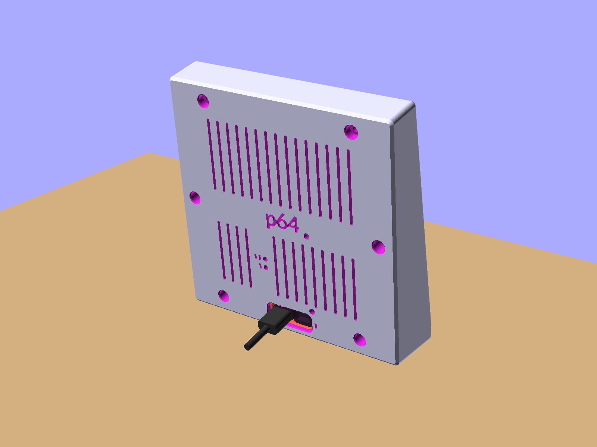
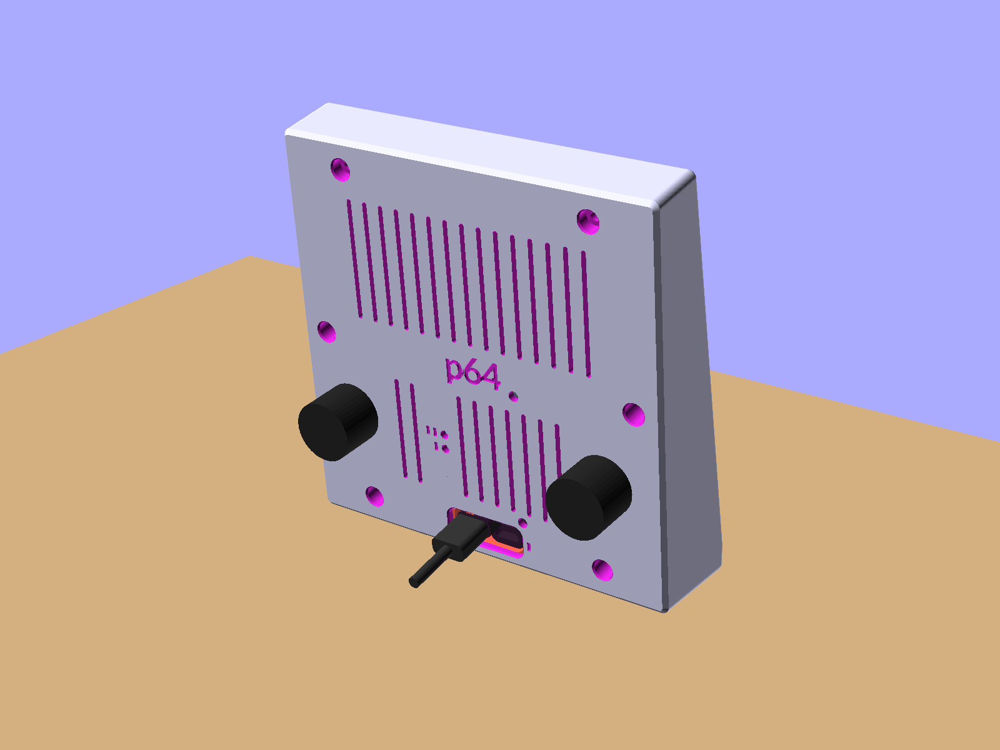

# p64 enclosure

A support-free tabletop shell for the Waveshare P2 64×64 panel and ESP32-S3 controller.
Both variants share a parametric OpenSCAD source and a separately printed cradle insert.

[Build and assembly](../docs/build-your-own.md) · [Design reference](design-reference.md) ·
[Current status](../docs/status.md)

## Choose the files

| p64a · no knobs | p64b · two knobs |
|---|---|
|  |  |

Design renders. Both variants are assembled (p64a 2026-10-09, p64b 2026-10-17).

| Variant | Source | Ready-to-print files |
|---|---|---|
| p64a, no knobs | [v7a](src/p64_enclosure_v7a.scad) | [output/p64a/v7a](output/p64a/v7a/) |
| p64b, two knobs | [v7b](src/p64_enclosure_v7b.scad) | [output/p64b/v7b](output/p64b/v7b/) |

Print `p64_enclosure_print.stl` (or `.3mf`) and `p64_cradle_insert.stl`. For MJF/SLA
services, use the larger-clearance `p64_enclosure_service.stl`. Both v7 shells are
printed, assembled and in daily use; p64b was closed on 2026-10-17 with its two
encoder boards on the pegs and the panel seated clear of them. Since 2026-10-20 the
files carry a rim 0.5 mm taller than those shells (the LED mask stands 0.5 mm proud of
it instead of 1.0, `proud` in the source) and a "p64" mark engraved in the back face
(`brand`, set it to `[]` for a plain back); neither revision is printed yet.

## Printing

No printer? The [build guide](../docs/build-your-own.md#b-order-the-shell-from-jlc3dp)
walks through ordering both parts from JLC3DP (FDM, PLA-P, black), which is how the
maintainer's shells were made.

PLA or PETG, 0.2 mm layers, 3–4 perimeters, 20% infill, no supports. Use a bed of at
least 140×140 mm and 0.1–0.2 mm elephant-foot compensation. The shell file already
lies on its back; print the insert sole down. Expect about 82 g plus under 2 g.

## Assembly

Follow the [build guide](../docs/build-your-own.md#c-assemble), including the adapter
fit check before gluing. The assembled v7a needs no panel-frame modification. Buy six M3×10 screws separately; the board
does not include them. p64b also needs the
[two-encoder wiring guide](../docs/hardware/encoders-soldered.md).

## Modify or inspect the design

Use OpenSCAD 2021.01 or later. Edit the shared [v7 source](src/p64_enclosure_v7.scad),
then regenerate both variants. The [design reference](design-reference.md) preserves:

- [Geometry](design-reference.md#what-the-design-does) and
  [USB-C tolerances](design-reference.md#usb-c-the-adapters-the-window-and-the-cradle-insert).
- [Unverified dimensions](design-reference.md#things-that-could-not-be-verified) and
  [measured v1 fit](design-reference.md#verified-with-the-v1-print).
- Parameters and [regeneration commands](design-reference.md#regenerating-the-outputs).

Hand measurements are in [input](input/measurements.md). Assumptions remain labelled;
assembled use does not establish every tolerance.

## Earlier designs

[v1–v6](archive/pre-v7/README.md) and the
[stand concept](archive/2026-08-stand-concept/README.md) remain for reference.
Existing v1 owners can use the [v1 build notes](archive/pre-v7/build-v1.md).
